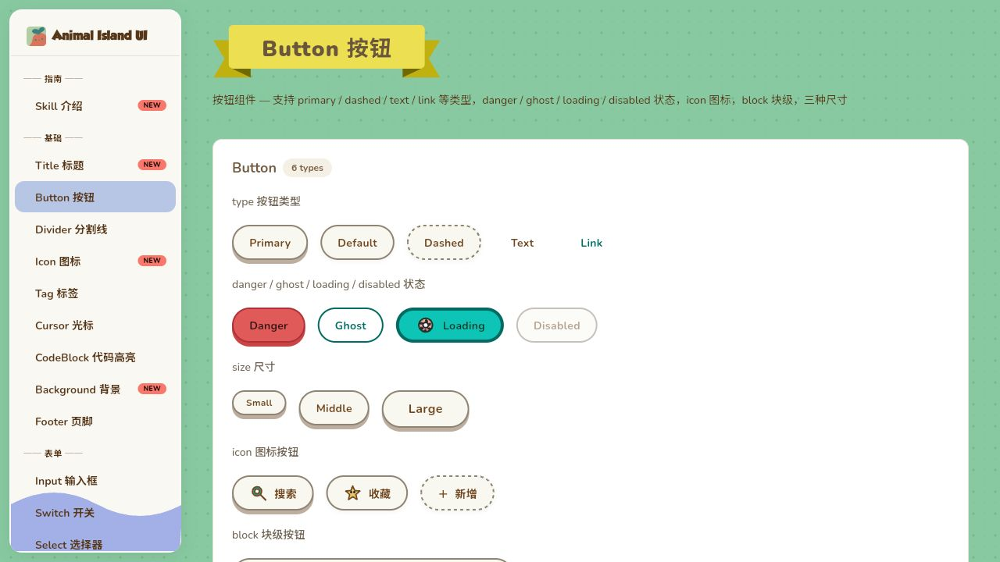

<div align="center">

# 🍃 Animal Island UI for Flutter

**A cozy island toolkit with tactile controls, patterned surfaces and ribbon titles.**

A fresh Flutter implementation of the [Animal Island UI design language](https://github.com/guokaigdg/animal-island-ui).


English · [简体中文](README.zh-CN.md)

**[Open the live Gallery](https://ibuprofenighty.github.io/animal-island-ui-flutter/) · [Component API](docs/API.md) · [AI usage Skill](skills/animal-island-ui-flutter/SKILL.md)**

</div>

## ✨ What’s inside

- **40 component families** for forms, navigation, data, feedback and island decoration, exposed through one public import.
- **163 SVG glyphs** through `IslandIcon` and `IslandGlyph`; multicolor artwork retains its own paint roles.
- **Light and dark theme presets**, semantic tokens and component styles with explicit, documented customization boundaries.
- **Composable interactions**: controlled values, caller-owned controllers, keyboard/focus behavior and reduced-motion contracts.
- **A live and local Gallery** with the component catalog, homepage and usage guide. English and Chinese defaults are available through `IslandLocalizations`; application copy remains yours.

This is **experimental 0.0.1**. It has not completed all-platform visual or production acceptance. See [verification status](#-verification-status) before adopting it.

## 🏝️ Explore the island

[**Open the Flutter Gallery →**](https://ibuprofenighty.github.io/animal-island-ui-flutter/)

[](https://ibuprofenighty.github.io/animal-island-ui-flutter/#/button)

| Start with | Preview |
| :--- | :--- |
| The island homepage and themes | [Home](https://ibuprofenighty.github.io/animal-island-ui-flutter/) |
| Tactile controls and form composition | [Button](https://ibuprofenighty.github.io/animal-island-ui-flutter/#/button) · [Select](https://ibuprofenighty.github.io/animal-island-ui-flutter/#/select) · [Form](https://ibuprofenighty.github.io/animal-island-ui-flutter/#/form) |
| Images, decoration and feedback | [Carousel](https://ibuprofenighty.github.io/animal-island-ui-flutter/#/carousel) · [Icon](https://ibuprofenighty.github.io/animal-island-ui-flutter/#/icon) · [Notification](https://ibuprofenighty.github.io/animal-island-ui-flutter/#/notification) |

This preview runs this repository’s Flutter implementation; the [upstream React Gallery](https://guokaigdg.github.io/animal-island-ui/#/) is the design reference. Start with desktop Chrome or Edge. A successful preview deployment does not mean complete acceptance; known limits are listed below.

## 📦 Install locally

Clone this repository for local path consumption. The package is not currently advertised as a pub.dev release. You can try the live Gallery without installing it.

```sh
git clone https://github.com/Ibuprofenighty/animal-island-ui-flutter.git animal_island_ui
```

Place this implementation’s checkout or extracted package in a sibling folder named `animal_island_ui`, then add:

```yaml
dependencies:
  animal_island_ui:
    path: ../animal_island_ui
```

Adjust the path to your actual location and run `flutter pub get`. The package identity and import are `animal_island_ui`; minimum SDK constraints live in [pubspec.yaml](pubspec.yaml).

## 🚀 Quick start

<details>
<summary>Show the complete Flutter example</summary>

```dart
import 'package:flutter/material.dart';
import 'package:animal_island_ui/animal_island_ui.dart';

void main() => runApp(const IslandApp());

class IslandApp extends StatelessWidget {
  const IslandApp({super.key});

  @override
  Widget build(BuildContext context) => MaterialApp(
    theme: IslandTheme.create(),
    localizationsDelegates: IslandLocalizations.delegates,
    supportedLocales: IslandLocalizations.supportedLocales,
    home: const IslandHome(),
  );
}

class IslandHome extends StatelessWidget {
  const IslandHome({super.key});

  @override
  Widget build(BuildContext context) => Scaffold(
    body: Center(
      child: SizedBox(
        width: 360,
        child: IslandCard(
          header: const IslandTitle(child: Text('Island plaza')),
          child: Column(
            mainAxisSize: MainAxisSize.min,
            children: [
              const IslandIcon(IslandGlyph.leaf, size: 32),
              const SizedBox(height: 12),
              const Text('A little space for everyday discoveries.'),
              const SizedBox(height: 20),
              IslandButton(
                variant: IslandButtonVariant.primary,
                onPressed: () => showIslandModal<void>(
                  context: context,
                  title: const Text('Welcome aboard'),
                  builder: (_) => const Text('Your island starts here.'),
                ),
                child: const Text('Explore'),
              ),
            ],
          ),
        ),
      ),
    ),
  );
}
```

</details>

Use `IslandTheme.create(brightness: Brightness.dark)` for a dark preset. Runtime theme switching and component customization follow the [API guide](docs/API.md) and the relevant [component contracts](#-documentation); examples do not imply arbitrary colors automatically meet contrast requirements.

## 🧩 Component catalog

The count refers to catalog families, rather than every helper class or group widget.

| Area | Components |
| :--- | :--- |
| General | Button, Icon, Typewriter, Cursor |
| Layout & decoration | Card, Title, Divider, Background, Footer, Collapse |
| Navigation | Tabs, Pagination, Carousel, BackTop |
| Forms & input | Input, Checkbox, Radio, Switch, Select, Rate, DatePicker, TimePicker, Form, Upload |
| Data display | Table, Tag, Image, Avatar, Badge, CodeBlock |
| Feedback | Tooltip, Notification, Loading, Skeleton, Progress |
| Time & counters | Time, Countdown, CountUp |
| Overlays | Modal, Drawer |

Public names include `IslandTextField`, `IslandRadioGroup`, `IslandCheckboxGroup` and the other declarations in [the public entrypoint](lib/animal_island_ui.dart).

## 🖼️ Run the Gallery

From a complete source checkout:

```bash
flutter pub get
cd example
flutter pub get
flutter run -d windows
# Or: flutter run -d chrome
```

The [Gallery guide](example/README.md) explains its setup and assets. The [original Web reference](https://guokaigdg.github.io/animal-island-ui/#/) is the upstream design reference, not a deployment of this Flutter implementation.

## 📚 Documentation

| Read | Purpose |
| :--- | :--- |
| [API guide](docs/API.md) · [public declarations](lib/animal_island_ui.dart) | Setup, composition and supported interfaces |
| [Design contracts](docs/DESIGN.md) | Theme, color, motion and reference decisions |
| [Acceptance scope](docs/ACCEPTANCE.md) | Evidence requirements and limits |
| [Architecture](ARCHITECTURE.md) · [maintenance](docs/MAINTENANCE.md) | Ownership, extension and development |
| [Agent usage Skill](skills/animal-island-ui-flutter/SKILL.md) · [中文](skills/animal-island-ui-flutter/SKILL.zh-CN.md) | Component-contract references and usage guidance |
| [Changelog](CHANGELOG.md) · [rights & provenance](docs/RIGHTS.md) | Change history and asset-specific terms |

## 🔎 Verification status

Windows and Web are the first acceptance targets; mobile acceptance is deferred. **Full-library acceptance remains incomplete.** The last independently reviewed runtime checkpoint retained **18 failing numerical measurements** for Notification/Tooltip under the documented accepted limitation; they are not reported as passing tests.

Five boundaries remain: qualified browser hover intermediate frames, an actual Edge 375px after-frame, OS/physical presentation, current-build onsite checks including the complete actual Web comparison, and an all-content 60fps claim. Details and named exceptions belong to [the acceptance contract](docs/ACCEPTANCE.md) and [design authority](docs/DESIGN.md), rather than this README.

Keyboard, semantics and contrast contracts remain in scope. Screen-reader execution is excluded from the current acceptance scope. No commercial-readiness or comprehensive accessibility certification is claimed.

## 📄 License & attribution

The new Dart implementation uses the [MIT license](LICENSE). Third-party glyphs, scenes, photos and fonts retain their own terms and [notices](NOTICE). The owner has confirmed distribution of the 21 scene/logo/photo assets and GROBOLD font with this public repository; this is not an unconditional commercial license or independent legal verification. See [rights and provenance](docs/RIGHTS.md) for the authoritative record.
